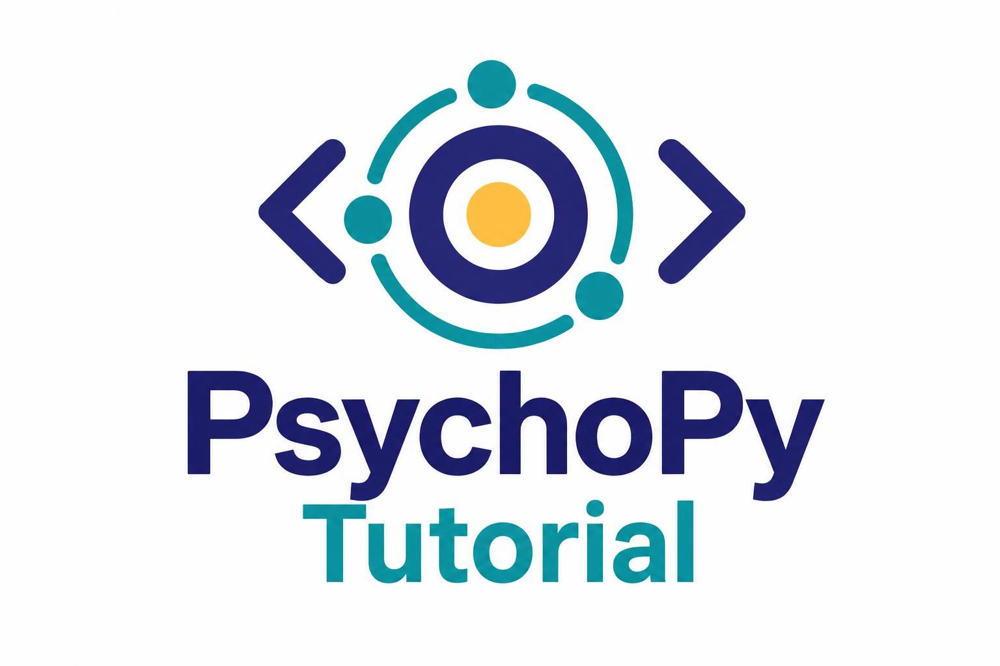

This website contains a quick introduction to PsychoPy, a Python library to program psychological experiments. The aim is to provide readers with an essential guide to the 6 steps that must be taken to set up a standard cognitive neuroscience experiment, where subjects watch some kind of visual stimuli during neuroimaging. While the tutorial focuses on visual stimuli, the principles it illustrates apply to any other type of stimulus.

 

---

:::{note} Disclaimer
The contents of this website are a reader-friendly version of material that the author, [Matteo De Matola](https://github.com/matteo-d-m), taught in Lecture 3.0 of [Python for (open) Neuroscience](https://github.com/vigji/python-cimec-2024) (2024 iteration), a course by Luigi Petrucco at the University of Trento's doctoral school in Cognitive \& Brain Sciences. 

This tutorial is **not** official, it was **not** written by PsychoPy developers, and it does **not** necessarily mirror best practices: it is merely an educational presentation of one user's experiences and insights, shared with the public in hope of serving the neuroscience and psychology communities.  
:::